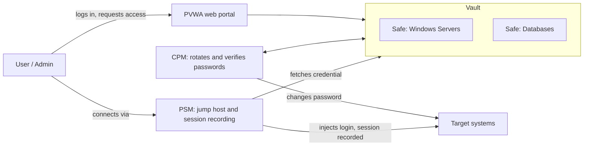

# PAM Basics: CyberArk Vault, Safes, CPM and PSM

My study notes on how CyberArk handles **Privileged Access Management (PAM)**.

## What problem does PAM solve?

Privileged accounts (admin, root, service accounts, database logins) can do the most damage if stolen. They are often shared, rarely rotated, and hard to audit. PAM puts these credentials in one protected place and controls who can use them, when, and how.

## The four building blocks

### 1. Vault (Digital Vault)
The hardened, encrypted storage server at the centre of CyberArk. It holds the privileged credentials (passwords, SSH keys) and keeps a tamper-resistant audit log. Everything else talks to the Vault. Users never touch it directly.

### 2. Safes
A Safe is a container inside the Vault. Accounts are grouped into Safes, for example one for Windows servers and another for databases. Each Safe has its own **permissions**: who can see an account, retrieve a password, or manage the Safe. Good Safe design follows *least privilege*: each team sees only what it needs.

### 3. CPM (Central Policy Manager)
The "password janitor." The CPM automatically **changes, verifies and reconciles** passwords on target systems according to policy (for example, rotate every 30 days). The Vault stores the new password, and nobody has to know it. If a password drifts out of sync with the real system, the CPM repairs it.

### 4. PSM (Privileged Session Manager)
The "controlled doorway." Instead of connecting straight to a server, a user connects **through the PSM**, which acts as a jump host. It can log the user in **without revealing the password**, and it **records and monitors the session** (RDP/SSH). Recordings support audits and investigations, and risky sessions can be terminated.

## Simple diagram



Text version:

```
 User ──► Portal (PVWA) ──► [ VAULT ]
                             ├─ Safe A (Windows servers)
                             └─ Safe B (Databases)
                                  ▲
                CPM ──────────────┘  rotates passwords on ──► Target systems
                                                                  ▲
 User ──► PSM (jump host, records session) ──────────────────────┘
          (gets credential from Vault, user never sees it)
```

## Typical flow

1. An admin needs access to a server.
2. They log in to the portal; their Safe permissions decide whether they can use that account.
3. They connect through the **PSM**, which pulls the password from the **Vault** and logs them in.
4. The session is **recorded**.
5. Afterwards the **CPM** rotates the password, so the one just used is no longer valid.

## One-line summary

| Component | Role in one line |
|-----------|------------------|
| Vault | Encrypted storage for privileged credentials |
| Safe | Permissioned container for accounts inside the Vault |
| CPM | Automatically rotates and verifies passwords |
| PSM | Proxies and records privileged sessions without exposing passwords |

## Why it matters for a SOC analyst

- Privileged account use is a prime place to look for attacks (for example, unusual checkout times or failed rotations).
- PSM recordings and Vault audit logs are useful evidence in investigations.
- Rotation and least-privilege Safes reduce the damage when a credential leaks.
